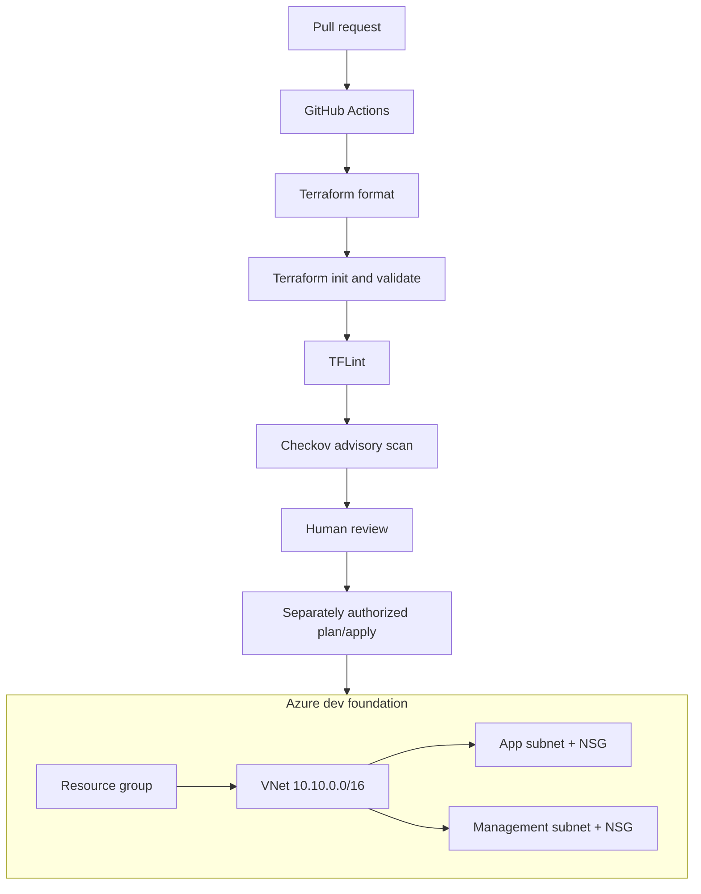

# Azure Enterprise DevSecOps Platform

> **Status:** Small Terraform foundation reference with resource-group and network modules, subnet-level NSG controls, and CI validation/lint/security scanning. No Azure deployment is claimed.

## Architecture



## Implemented

- Reusable resource-group module with tags.
- Reusable network module with a VNet, application subnet and management subnet.
- Dedicated NSGs associated with both subnets.
- Application NSG permits TCP/443 only from the VNet service tag; it does not create a public Internet ingress path.
- Management subnet has no custom inbound allow rule. Add access only after designing an approved VPN, Bastion or private jump-host route.
- Terraform environment root with explicit variables and outputs.
- GitHub Actions formatting, backend-free initialization, validation, TFLint and advisory Checkov scanning.

## Repository layout

- infrastructure/environments/dev — Terraform environment root
- infrastructure/modules/resource-group — resource group module
- infrastructure/modules/network — VNet, subnets, NSGs and associations
- docs/security-review-checklist.md — review items for production hardening

## Validate locally

From the repository root:

```bash
terraform -chdir=infrastructure/environments/dev fmt -check -recursive
terraform -chdir=infrastructure/environments/dev init -backend=false
terraform -chdir=infrastructure/environments/dev validate
tflint --recursive
checkov -d infrastructure --framework terraform
```

Checkov is currently advisory in CI while the baseline is reviewed; findings must be triaged rather than ignored. A passing syntax/lint workflow does not establish Azure policy compliance or runtime security.

## Security and operations

- Use short-lived Azure OIDC federation for CI identities.
- Protect remote Terraform state and enable locking before team use.
- Scope ingress to trusted network paths; do not equate an NSG rule with a complete perimeter.
- Add route tables, private endpoints/DNS, diagnostics, policy assignments, workload identity and backup/recovery according to actual workload needs.
- Review cost, region/SKU availability and subscription permissions before any deployment.
- Never commit credentials, Terraform state, plan files or real variable files.

## Author

MD Amirul Haque · [GitHub profile](https://github.com/haqueamir70-coder) · [LinkedIn](https://www.linkedin.com/in/md-amirul-haque/)


## Architecture and interview preparation

See the [architecture diagram and interview questions](docs/README.md) for the repository-specific design walkthrough and technical interview guide.
