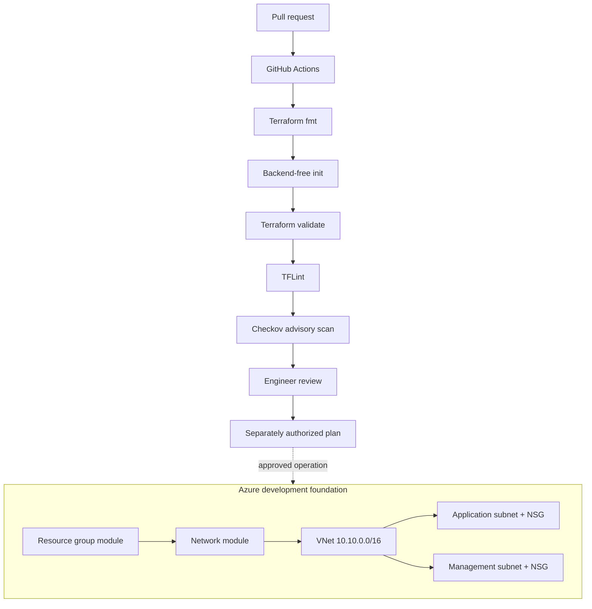

<div align="center">


### Reusable cloud foundations · Secure delivery gates · Network isolation

[](https://azure.microsoft.com/)
[](https://developer.hashicorp.com/terraform)
[](https://docs.github.com/actions)
[](https://owasp.org/www-project-devsecops-guideline/)

**A compact enterprise foundation showing how reusable Terraform modules, subnet-level controls and automated code checks fit into an Azure DevSecOps workflow.**

[Architecture](#-architecture) · [Modules](#-module-catalogue) · [Validate](#-local-validation) · [Security checklist](#-security-review)

</div>

> [!NOTE]
> This is a small Terraform foundation reference, not a deployed Azure environment. The diagram shows the intended resource composition; no Azure deployment is claimed.

## Engineering objective

Build a clean, reviewable starting point for Azure infrastructure: isolate application and management network segments, keep resource definitions reusable, and make code quality/security checks part of pull requests.

## Architecture



## Module catalogue

| Module / layer | Responsibility |
|---|---|
| `infrastructure/modules/resource-group` | Reusable resource-group creation and tags |
| `infrastructure/modules/network` | VNet, application and management subnets |
| Network security groups | Separate policy attachment for each subnet |
| `infrastructure/environments/dev` | Development root module, inputs and outputs |
| GitHub Actions | Format, init, validate, lint and advisory IaC scan |

## Network security model

- **Application subnet:** sample inbound TCP/443 is scoped to the VNet service tag. This does not create public Internet ingress.
- **Management subnet:** no custom inbound allow rule is defined; default inbound deny remains in effect.
- **Administrative access:** add VPN, Azure Bastion or a private jump-host route only after defining the trust boundary and operator identity.
- **Egress and routing:** NSGs are not a complete perimeter. Review outbound access, UDRs, DNS, private endpoints and diagnostics for the target workload.

## Local validation

```bash
terraform -chdir=infrastructure/environments/dev fmt -check -recursive
terraform -chdir=infrastructure/environments/dev init -backend=false
terraform -chdir=infrastructure/environments/dev validate
tflint --recursive
checkov -d infrastructure --framework terraform
```

Check the workflow for the exact tool versions and working directories. Checkov is advisory while the baseline is reviewed; findings must be triaged and tracked, not ignored. A green static-analysis run does not establish cloud runtime security.

## Security review

- [ ] Configure remote state with encryption, locking and restricted access.
- [ ] Use OIDC federation for CI identities rather than stored long-lived secrets.
- [ ] Scope Azure roles to the required resources and operations.
- [ ] Add private endpoints and private DNS only where the workload requires them.
- [ ] Define ingress and egress paths explicitly.
- [ ] Enable diagnostics and route logs to an owned monitoring destination.
- [ ] Review region, SKU, quotas and cost before any apply.
- [ ] Document rollback and teardown.

## Repository map

```text
infrastructure/
  environments/dev/       # Terraform root module
  modules/resource-group/ # Resource group module
  modules/network/        # VNet, subnets and NSGs
.github/workflows/        # CI checks
docs/
  security-review-checklist.md
```

## Project documentation

- [Architecture and interview guide](docs/README.md)
- [Zero-to-hero implementation guide](docs/ZERO-TO-HERO.md)
- [Advanced interview bank](docs/ADVANCED-INTERVIEW-BANK.md)
- [Security review checklist](docs/security-review-checklist.md)

## Maintainer

**MD Amirul Haque** · [GitHub](https://github.com/haqueamir70-coder) · [LinkedIn](https://www.linkedin.com/in/md-amirul-haque/)

<sub>Make infrastructure reusable. Make security reviewable. Make change deliberate.</sub>
