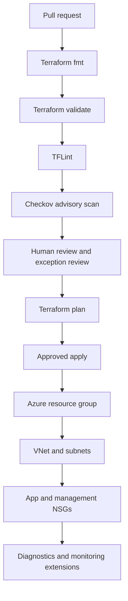

# Enterprise Azure DevSecOps foundation — Architecture & Interview Guide

Modular Terraform delivery with network segmentation, quality gates and security scanning. Check the module outputs and deployment root before treating this as a complete landing zone.

## Architecture diagram

## Interview questions

1. 1. How would you structure Terraform modules for enterprise Azure foundations?
2. 2. Why should each module declare its own provider requirements?
3. 3. How do TFLint, Checkov and terraform validate differ?
4. 4. How do you design separate management and application subnets?
5. 5. How should NSGs be associated with subnets?
6. 6. How do you manage module versioning and breaking changes?
7. 7. What belongs in a reusable module output contract?
8. 8. How do you handle Checkov exceptions without hiding risk?
9. 9. How would you add remote state, OIDC and environment approvals?
10. 10. What additional controls are needed before calling this an enterprise landing zone?

## Interview preparation note
For each answer, cover the design rationale, trust boundary, failure mode, operational telemetry and validation method. Distinguish implemented, CI-validated, cloud-deployed and planned capabilities.
