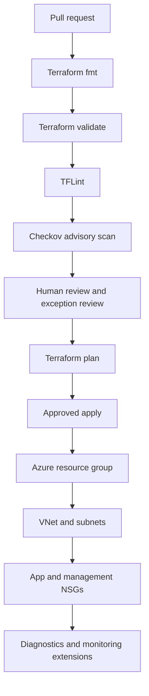

# Enterprise Azure DevSecOps foundation — Architecture & Interview Guide

Modular Terraform delivery with network segmentation, quality gates and security scanning. Check the module outputs and deployment root before treating this as a complete landing zone.

## Architecture diagram

## Interview questions

1. 1. How would you structure Terraform modules for enterprise Azure foundations?
2. 2. Why should each module declare its own provider requirements?
3. 3. How do TFLint, Checkov and terraform validate differ?
4. 4. How do you design separate management and application subnets?
5. 5. How should NSGs be associated with subnets?
6. 6. How do you manage module versioning and breaking changes?
7. 7. What belongs in a reusable module output contract?
8. 8. How do you handle Checkov exceptions without hiding risk?
9. 9. How would you add remote state, OIDC and environment approvals?
10. 10. What additional controls are needed before calling this an enterprise landing zone?

## Interview preparation note
For each answer, cover the design rationale, trust boundary, failure mode, operational telemetry and validation method. Distinguish implemented, CI-validated, cloud-deployed and planned capabilities.

## Interview questions — suggested answers

### 1. Answer

Split modules by stable capability boundaries such as networking, identity, policy and monitoring. Keep the root composition thin, expose typed inputs/outputs and pin module/provider versions.

### 2. Answer

Each module should declare compatible Terraform and provider constraints so it can be validated and consumed independently. Root configurations select concrete provider versions via the lock file.

### 3. Answer

validate checks configuration semantics; TFLint checks style/provider-specific issues; Checkov evaluates known security misconfigurations. None alone proves runtime security.

### 4. Answer

Use separate subnets and route/security controls for management and workloads. Management access should be restricted to approved admin paths and audited.

### 5. Answer

Subnet association applies the NSG rules to resources in that subnet; without association, the NSG object itself does not enforce traffic filtering.

### 6. Answer

Use semantic versioning, changelogs, compatibility tests and a deprecation window. Avoid breaking input/output changes without a major version and migration guide.

### 7. Answer

Expose only stable identifiers and values consumers need, such as resource IDs, subnet IDs and private endpoint references. Avoid leaking secrets or implementation details.

### 8. Answer

Document the violated control, reason, compensating control, owner, expiry and remediation. Keep exceptions visible and time-limited rather than suppressing findings globally.

### 9. Answer

Add a remote backend, OIDC identity, environment approvals, plan review, policy gates, diagnostics and integration tests before applying in a real subscription.

### 10. Answer

A landing zone also needs identity governance, management groups, policy assignments, connectivity, DNS, centralized logging, operational ownership and tested recovery. A network module alone is not a full landing zone.